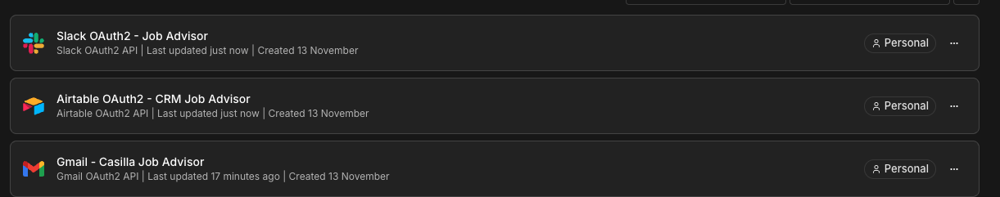
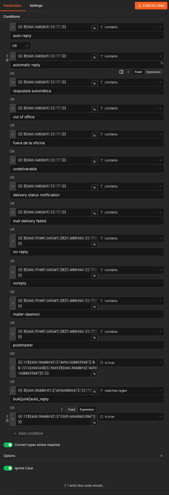
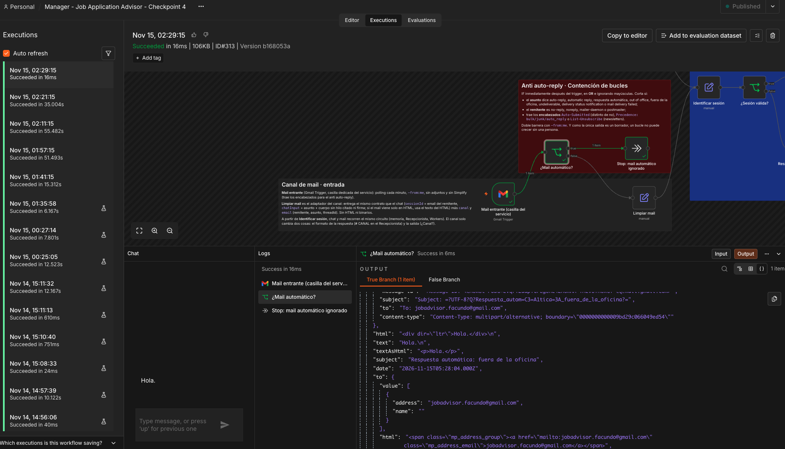
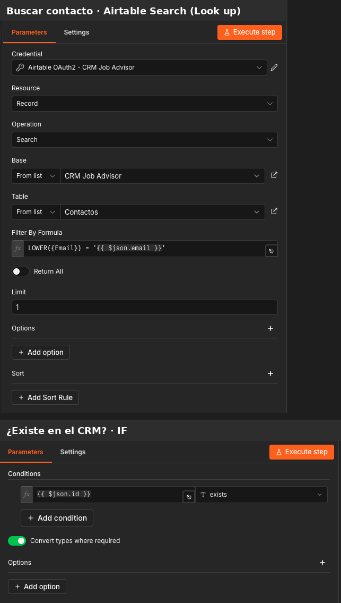
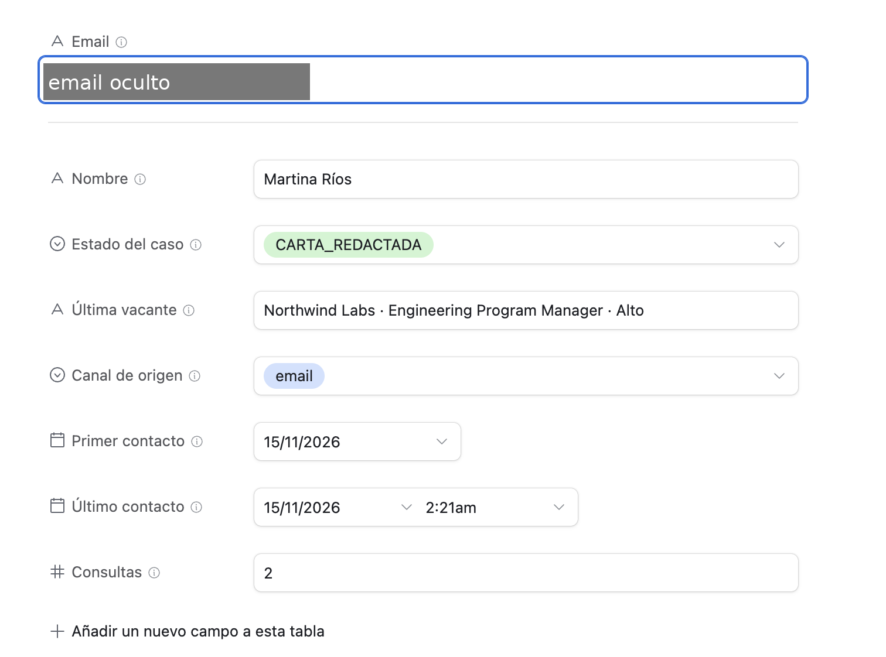
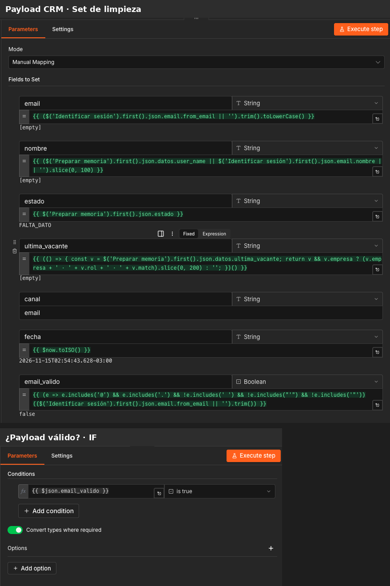
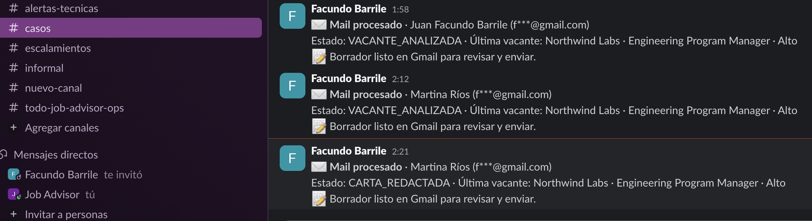
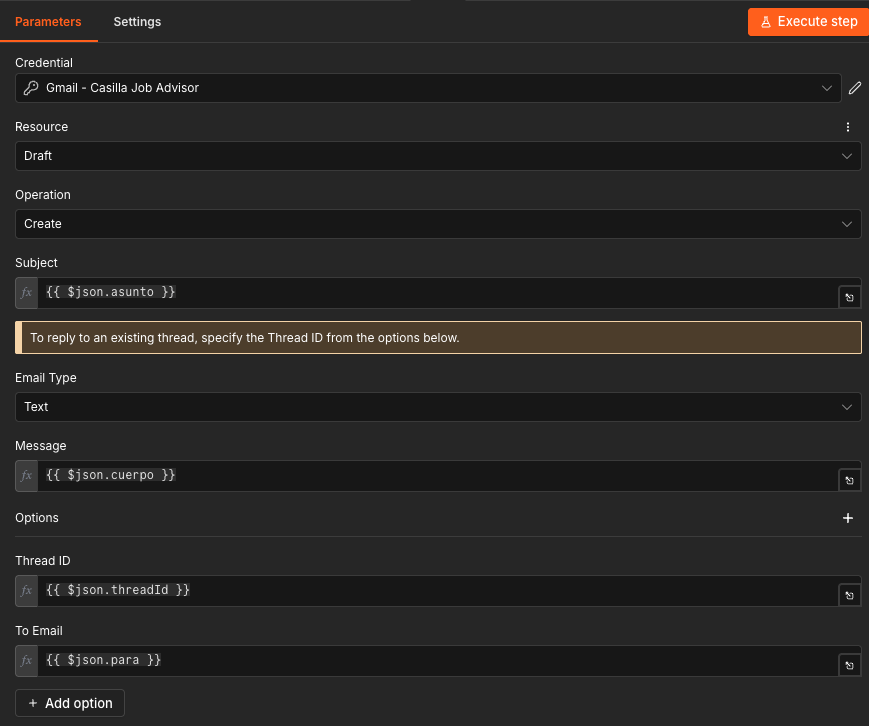
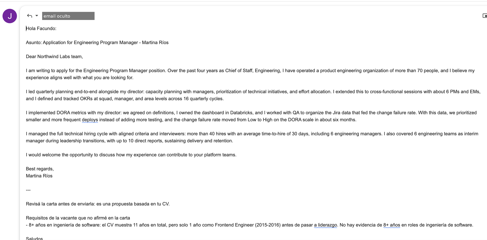
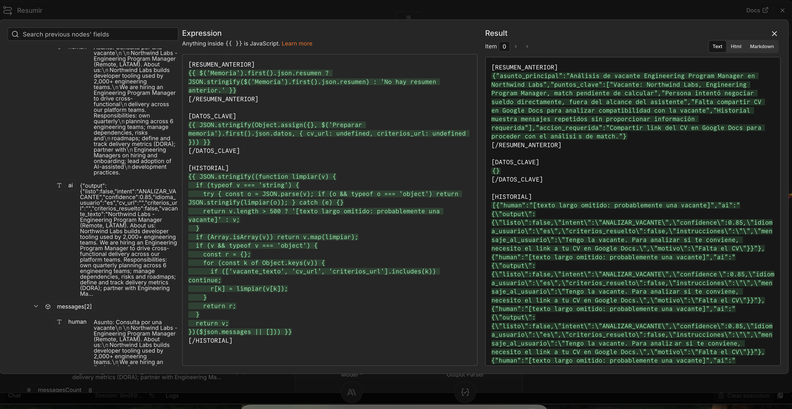

# Job Application Advisor

Asistente de postulaciones para búsqueda laboral y outplacement. Proyecto integrador del curso AI Automation Avanzado (Coderhouse).

## Estado del proyecto

| Checkpoint | Módulo | Qué suma | Archivos |
|---|---|---|---|
| 1 | Agentes autónomos | Agente base que analiza una vacante contra el CV y escribe la cover letter | `checkpoint1_facundo_barrile.json` |
| 2 | Arquitectura multi-agente | Manager con Recepcionista + Workers Analista y Redactor (sub-workflows), log y manejo de fallos | Incluidos en `checkpoint-3/` (evolucionados) |
| 3 | Memoria, contexto y persistencia | Memoria persistente por sesión en Airtable, inyección con delimitadores y resumen automático | `checkpoint-3/` |
| 4 | Integraciones avanzadas | Canal de mail con borrador en el hilo (HITL), CRM sin duplicados en Airtable y avisos al equipo por Slack, con OAuth2 y mínimo privilegio | `checkpoint4_facundo_barrile.json`, `checkpoint-4/` |


## Checkpoint 4 · Integraciones: canal de mail, CRM y Slack

**Módulo:** 4 · Integraciones Avanzadas e Interconexión de Sistemas
**Archivos:** `checkpoint4_facundo_barrile.json` (Manager, en la raíz del repo), `checkpoint-4/worker-analista.json`, `checkpoint-4/worker-redactor.json`

### Qué hace

El asistente suma un **canal de mail**. La persona escribe a la casilla del servicio con una vacante y el link a su CV, igual que en el chat, y el mismo sistema multi-agente del CP3 la atiende. La respuesta no se envía: queda como **borrador en el mismo hilo** para que una persona del equipo la revise y la envíe. En cada mail, el flujo actualiza la **ficha de la persona en el CRM** (sin duplicados) y avisa al **equipo por Slack**.

| Herramienta | Lee | Escribe |
|---|---|---|
| Gmail (casilla dedicada del servicio) | Mails nuevos (trigger) | Borrador en el hilo (Create Draft) |
| CRM (Airtable, base `CRM Job Advisor`) | El contacto por email (Search) | Create o Update del contacto |
| Slack (workspace del equipo) | — | `#casos`, `#escalamientos`, `#alertas-tecnicas` |

### Arquitectura

```
Gmail Trigger (casilla del servicio, -from:me, cada minuto)
 → ¿Mail automático? (IF, OR, ignora mayúsculas) ── true → Stop
 → Limpiar mail (adaptador: mismo contrato que el chat + canal y email)
 → Identificar sesión (valida por canal) ← Chat Trigger
 → [circuito del CP3 sin cambios: memoria → Recepcionista → Switch → Workers → memoria → resumen]
 → Respuesta final → ¿Canal?
     ├ chat  → Fin: respuesta por chat
     └ email → Payload CRM → ¿Payload válido? ── no → alerta
              → Buscar contacto → ¿Búsqueda OK? ── no → Alerta CRM (y el borrador sale igual)
              → ¿Existe en el CRM? ── sí → Actualizar contacto / no → Crear contacto
              → Componer mail → Borrador de respuesta (Draft, mismo hilo)
              → Mensaje para Slack → #casos · ¿Requiere persona? → #escalamientos
```

**Decisión de diseño:** el canal de mail es un segundo trigger en el mismo Manager, con un adaptador (`Limpiar mail`) que entrega el mismo contrato que el chat (`sessionId`, `chatInput`). A partir de `Identificar sesión`, chat y mail recorren el mismo circuito. El canal cambia solo dos cosas: el formato de la respuesta (sección `# CANAL` en el prompt del Recepcionista) y la salida (`¿Canal?`). En el mail, el `sessionId` es el email del remitente, así que la memoria del CP3 reconoce a la persona entre mails.

### 1. Conectividad segura y mínimo privilegio

Las tres integraciones usan **OAuth2**, cada una con su credencial:



| Integración | Credencial | Operaciones del flujo | Permisos otorgados |
|---|---|---|---|
| Gmail | `Gmail - Casilla Job Advisor` | Trigger y Draft > Create | Solo `gmail.modify`, con el consentimiento granular de Google. n8n pide 6 scopes; quedaron afuera el borrado permanente, `gmail.compose`, `gmail.labels` y los de complementos. Cuenta dedicada al servicio |
| CRM | `Airtable OAuth2 - CRM Job Advisor` | Search, Create y Update | `data.records:read`, `data.records:write` y `schema.bases:read`, con acceso a **una sola base** |
| Slack | `Slack OAuth2 - Job Advisor` | Enviar mensaje a 3 canales fijos | Solo `chat:write` y `channels:read`. Se descartó el manifest de la documentación de n8n (17 scopes de bot y 10 de usuario) |

**Dos límites de los proveedores, y cómo se cubren:**
- Gmail no tiene un scope de solo borradores: `gmail.modify` permite enviar. El "nunca envía" lo garantiza el diseño: la única salida de correo es Create Draft.
- En Airtable, `data.records:write` incluye borrar. El flujo no tiene nodos Delete.

La memoria (Airtable con token) y el log (Google Sheets) siguen con sus credenciales del CP3.

<details>
<summary>Evidencia: consentimientos y credenciales conectadas</summary>

- [Gmail: solo `gmail.modify`](checkpoint-4/capturas/01-gmail-consentimiento-granular.png)
- [Airtable: acceso a una sola base](checkpoint-4/capturas/02-airtable-acceso-una-base.png)
- [Slack: solo dos scopes de bot](checkpoint-4/capturas/03-slack-scopes-minimos.png)
- Credenciales conectadas: [Gmail](checkpoint-4/capturas/04a-credencial-gmail-conectada.png) · [Airtable](checkpoint-4/capturas/04b-credencial-airtable-conectada.png) · [Slack](checkpoint-4/capturas/04c-credencial-slack-conectada.png)

</details>

### 2. Contención de bucles y mitigación de errores

#### IF anti auto-reply

Va inmediatamente después del trigger. Corta el mail si cumple **cualquiera** de 15 condiciones (OR), **ignorando mayúsculas**:
- **Asunto:** auto-reply, automatic reply, respuesta automática, out of office, fuera de la oficina, undeliverable, delivery status notification o mail delivery failed.
- **Remitente:** no-reply, noreply, mailer-daemon o postmaster.
- **Encabezados:** `Auto-Submitted` distinto de "no", `Precedence: bulk/junk/auto_reply` o `List-Unsubscribe` (newsletters).

El asunto no alcanza: un newsletter no dice "respuesta automática", pero trae `List-Unsubscribe`. Por eso el trigger va sin Simplify, para traer los encabezados. Además hay una doble barrera: el trigger filtra `-from:me`, y como la única salida es un borrador, un bucle no puede crecer sin una persona.

<details>
<summary>Configuración del IF (15 condiciones)</summary>



</details>

**Prueba:** un mail con asunto "Respuesta automática: fuera de la oficina" sale por true y frena en el Stop. Corrieron 3 nodos en **16 ms**, contra los 35 a 55 s de un mail normal: el filtro corta antes de gastar tokens del LLM y antes de tocar Airtable.



#### Look up antes del Create (evita el 409)

`Buscar contacto` busca por email antes de escribir: si existe, actualiza; si no, crea. Hay una sola ficha por persona.
- **`LOWER({Email})` en la fórmula**, y el email llega en minúsculas desde el payload: una mayúscula no alcanza para crear un duplicado.
- **Always Output Data:** si no encuentra nada, Search devuelve cero ítems y el flujo se cortaría. Con la opción activa emite un ítem vacío, `$json.id` no existe y el IF va a Crear.
- **`¿Búsqueda OK?` antes de decidir:** Always Output Data con On Error Continue también emite un ítem sin `id` cuando Airtable falla, y el flujo crearía un duplicado. Es la lección del CP3: si hay error, va a la alerta y no al Create.
- Create y Update tienen salida de error: alerta en `#alertas-tecnicas`, y el borrador sale igual. Que el CRM esté caído no deja a la persona sin respuesta.

<details>
<summary>Configuración: Buscar contacto, Settings y ¿Existe en el CRM?</summary>



</details>

**Prueba:** el segundo mail de la misma persona pasó por Update: Consultas en 2, Primer contacto sin cambios y una sola fila. Sin la compuerta, la segunda consulta [duplicaba el contacto](checkpoint-4/capturas/14-sin-compuerta-duplicado.png): un CRM simulado no rechaza duplicados, así que el 409 se convierte en una fila repetida en silencio.



#### Payload limpio y validado (evita el 400)

- **`Payload CRM`** deja solo 7 campos: el email normalizado (`trim().toLowerCase()`), el nombre, el estado, la última vacante como `empresa · rol · match`, el canal, la fecha y `email_valido`. Los textos tienen tope (`slice`). Nunca pasa el texto del CV, de la vacante ni de la carta.
- **El Set calcula y el IF decide:** `email_valido` exige `@` y `.`, sin espacios ni comillas. `¿Payload válido?` frena antes de Airtable. Sin comillas, la fórmula `'{{ $json.email }}'` de la búsqueda no se puede romper: se evitan el 400 y la inyección de fórmulas.
- **`Mensaje para Slack`** (antes de los 3 nodos de Slack): texto corto, de hasta 600 caracteres, con el email enmascarado (`f***@dominio`). Nunca el cuerpo del mail.

<details>
<summary>Configuración: Payload CRM y ¿Payload válido?</summary>



La vista previa de cada expresión se calculó sin un mail cargado: por eso `email` aparece vacío y `email_valido` en false.

</details>



### 3. Gobernanza operativa y HITL

#### Create Draft

`Componer mail` arma la respuesta como correo (saludo, sin markdown, firma "Equipo Job Advisor"). `Borrador de respuesta` usa **Gmail Draft > Create**, en el mismo hilo (`threadId`) y para el remitente. Es el único nodo de salida de correo del workflow: ninguno envía. Una persona revisa, edita y aprieta Enviar.

<details>
<summary>Configuración del borrador</summary>



</details>



**El HITL en la práctica:** en la corrida final, quien revisó el borrador del análisis borró un primer párrafo que contradecía el contenido antes de enviarlo. Y la carta propuso un gap que no existe (dijo que no había evidencia de 8 años de ingeniería, cuando el CV tiene roles de desarrollo de 2007 a 2016) y atribuyó mal una cifra. Enviada sola, la carta habría salido con los dos errores.

### Nomenclatura: el mismo dato en cada sistema

| Dato | Entrada (`Limpiar mail`) | Memoria (Airtable) | `Payload CRM` | CRM (`Contactos`) | Slack |
|---|---|---|---|---|---|
| Email | `email.from_email`, `sessionId` | `Session_ID` | `email` | Email | `f***@dominio` |
| Nombre | `email.nombre` | `user_name` (Datos clave, desde el CV) | `nombre` | Nombre | sí |
| Estado | — | Estado del caso | `estado` | Estado del caso | Estado |
| Última vacante | — | `ultima_vacante` (empresa, rol, match…) | `ultima_vacante` (`empresa · rol · match`) | Última vacante | Última vacante |
| Canal | `canal` | — | `canal` | Canal de origen | — |
| Fecha | — | Fecha de actualización | `fecha` | Primer contacto (Create) / Último contacto | — |

### Ejemplos JSON (datos de ejemplo)

Salida de `Limpiar mail`: el mismo contrato que el chat, más `canal` y `email`.

```json
{
  "canal": "email",
  "sessionId": "candidata@ejemplo.com",
  "chatInput": "Asunto: Evaluación de vacante\n\nNorthwind Labs - Engineering Program Manager (Remote, LATAM)... Mi CV: https://docs.google.com/document/d/...",
  "email": {
    "from_email": "candidata@ejemplo.com",
    "nombre": "Martina Ríos",
    "asunto": "Evaluación de vacante",
    "threadId": "19a8...",
    "messageId": "<CAO...@mail.gmail.com>"
  }
}
```

`Payload CRM`:

```json
{
  "email": "candidata@ejemplo.com",
  "nombre": "Martina Ríos",
  "estado": "CARTA_REDACTADA",
  "ultima_vacante": "Northwind Labs · Engineering Program Manager · Alto",
  "canal": "email",
  "fecha": "2026-11-15T02:21:00.000-03:00",
  "email_valido": true
}
```

Mensaje para `#casos`:

```
✉️ Mail procesado · Martina Ríos (c***@ejemplo.com)
Estado: CARTA_REDACTADA · Última vacante: Northwind Labs · Engineering Program Manager · Alto
📝 Borrador listo en Gmail para revisar y enviar.
```

### Pruebas

Las pruebas usaron mails reales, con el workflow publicado, y un **CV ficticio** para no exponer datos personales. El email del remitente está tapado en las capturas.

| # | Caso | Resultado | Evidencia |
|---|---|---|---|
| 1 | Mail con vacante y CV | Borrador con el análisis (match Alto), **Create** en el CRM y aviso en `#casos` | [Slack](checkpoint-4/capturas/27a-slack-casos-vacante-analizada.png) · [Memoria](checkpoint-4/capturas/27b-memoria-vacante-analizada.png) · [CRM](checkpoint-4/capturas/27c-crm-vacante-analizada.png) |
| 2 | Respuesta en el mismo hilo: "Escribime la cover letter" | La memoria recuerda el CV y la vacante. Carta en el hilo, **Update** (Consultas 2) | [Memoria](checkpoint-4/capturas/28b-memoria-carta-redactada.png) · [CRM](checkpoint-4/capturas/28c-crm-update-consultas-2.png) · [Borrador](checkpoint-4/capturas/28d-borrador-cover-letter.png) |
| 3 | Asunto "Respuesta automática: fuera de la oficina" | Stop en el IF en 16 ms: sin LLM, sin CRM, sin Slack | [Ejecución](checkpoint-4/capturas/29-mail3-autoreply-stop-16ms.png) |
| 4 | Asunto "Automatic Reply" (con mayúsculas) | Stop: el IF ignora mayúsculas | [Ejecución](checkpoint-4/capturas/05-if-autoreply-prueba-b-asunto.png) |
| 5 | Newsletter con `List-Unsubscribe` y asunto normal | Stop por el encabezado | [Ejecución](checkpoint-4/capturas/06-if-autoreply-prueba-e-newsletter.png) |
| 6 | Remitente `x'@mal.com` (comilla) | `session_valida: false`: no llega a la fórmula de Airtable | [Ejecución](checkpoint-4/capturas/07-remitente-invalido-no-llega-a-airtable.png) |
| 7 | Create sin la compuerta (simulación del 409) | Contacto duplicado | [CRM](checkpoint-4/capturas/14-sin-compuerta-duplicado.png) |
| 8 | Segunda consulta con la compuerta | Update, una sola fila | [CRM](checkpoint-4/capturas/11-crm-una-sola-fila.png) |
| 9 | Búsqueda en el CRM con fórmula inválida (CRM caído) | Alerta en `#alertas-tecnicas`, el borrador sale igual | [Slack](checkpoint-4/capturas/19-slack-alerta-crm-caido.png) |
| 10 | Update con un `id` inexistente | Salida de error, alerta y borrador igual | [Ejecución](checkpoint-4/capturas/24-update-crm-falla-rama-error.png) · [Alerta](checkpoint-4/capturas/25-alerta-crm-update-fallido.png) |
| 11 | Enviados de la casilla después de las pruebas | Vacío: el flujo nunca envía | [Gmail](checkpoint-4/capturas/16-gmail-enviados-vacio.png) |
| 12 | Regresión del chat | Sale por `¿Canal?` = chat. Sin CRM, Slack ni Gmail | [Ejecución](checkpoint-4/capturas/30-regresion-chat.png) |
| 13 | Vacante completa en el historial antes del resumen | Haiku recibe "[texto largo omitido]": sin requisitos ni ubicación | Ver abajo |

### Hallazgo del CP3, cerrado

En el CP3, el resumen de Haiku guardaba requisitos de la vacante. Ahora, antes del modelo, una función limpia el historial: borra `vacante_texto`, `cv_url` y `criterios_url` de cualquier mensaje, y reemplaza todo texto de más de 500 caracteres por "[texto largo omitido]". Empresa, rol y match le llegan por DATOS_CLAVE. La limpieza no se confía solo al prompt.



### Límites conocidos y próximos pasos

- **Varios mails en el mismo minuto:** el trigger los entrega como ítems de una sola ejecución, y el cerebro del CP3 lee con `.first()`. Hoy se mitiga con polling cada minuto y bajo volumen. Arreglo de fondo: el cerebro como sub-workflow, con una ejecución por mail.
- **Memoria corta en RAM:** si n8n se reinicia entre el análisis y "escribime la carta", hay que volver a pegar la vacante. El CV y los criterios sí vuelven desde Airtable.
- **Slack publica con el nombre del usuario que autorizó la app, no como el bot.** Se acota con un workspace dedicado, una sola operación y 3 canales fijos.
- **Una credencial vencida se clasifica como error funcional ("CV ilegible"), no técnico:** no salta la alerta. Mejora: que el Worker distinga los errores de autenticación.
- **Fidelidad de la carta:** el gap falso de la prueba 2 confirma que hace falta el control de fidelidad previsto para el Módulo 8. Hasta entonces, lo cubre el HITL.

### Para importar el Checkpoint 4

1. Importar `checkpoint4_facundo_barrile.json` (Manager) y los dos Workers de `checkpoint-4/`. En el Manager, apuntar `Llamar Analista` y `Llamar Redactor` a los Workers importados.
2. Airtable: la base de la memoria del CP3 y una base aparte con la tabla `Contactos`: Email (texto, primario), Nombre (texto), Estado del caso (selección única, mismos 6 valores que la memoria), Última vacante (texto), Canal de origen (selección única: email, chat), Primer contacto (fecha), Último contacto (fecha y hora) y Consultas (número). Credencial OAuth2 con los 3 scopes y acceso solo a esa base.
3. Gmail: una casilla dedicada, con credencial OAuth2. En el consentimiento, otorgar solo "Leer, redactar y enviar correos".
4. Slack: una app con `chat:write` y `channels:read`, el bot invitado a los 3 canales y sus IDs en los nodos de Slack.
5. Credenciales de Anthropic, Google Docs y Google Sheets, como en el CP3.
6. Publicar el workflow: el Gmail Trigger solo hace polling con el workflow activo.

## Checkpoint 3 · Memoria persistente y resumen automático

**Módulo:** 3 · Memoria, Contexto y Persistencia
**Archivos:** `checkpoint-3/manager.json`, `checkpoint-3/worker-analista.json`, `checkpoint-3/worker-redactor.json`

### Qué hace

El asistente recuerda a cada persona entre conversaciones sin mezclar datos: el CV, si ya resolvió sus criterios, la última vacante analizada y un resumen de lo conversado. Quien vuelve no repite datos, y el Recepcionista la saluda por su nombre y retoma lo pendiente.

### Arquitectura

```
Chat → Identificar sesión → ¿Sesión válida? → Buscar memoria (Airtable, filtro por Session_ID) → ¿Lectura OK?
     → ¿Tiene memoria? ─ no → Crear memoria ─┐
                         └ sí ───────────────┴→ Memoria (bloque de contexto)
     → Recepcionista (memoria entre delimitadores) → Switch → Workers del Checkpoint 2
     → Preparar memoria → Guardar memoria → ¿Más de 5 intercambios?
         └ sí → Leer historial → Resumir (Claude Haiku 4.5, JSON estricto) → Guardar resumen
     → Respuesta final
```

**Memoria híbrida:**
- **Corta:** la ventana de 20 mensajes del Recepcionista, con la tarea en curso.
- **Larga:** una fila por sesión en Airtable, que sobrevive a reinicios.

### Esquema de la base (Airtable, tabla `Memoria`)

| Campo | Tipo | Contenido |
|---|---|---|
| Session_ID | Texto (primario) | sessionId del chat: toda lectura y escritura filtra por este valor |
| Fecha de actualización | Fecha y hora | Última escritura |
| Resumen consolidado | Texto largo (JSON) | `asunto_principal`, `puntos_clave`, `accion_requerida` |
| Estado del caso | Selección única | NUEVO, FALTA_DATO, VACANTE_ANALIZADA, CARTA_REDACTADA, FUERA_DE_ALCANCE, ERROR |
| Datos clave | Texto largo (JSON) | Nombre, links al CV y a los criterios, criterios resueltos, 5 datos de la última vacante y contadores |
| Intercambios | Número | Contador desde el último resumen |

**Nunca se guarda:** texto del CV, de la vacante ni de la carta, ni la conversación.

### Decisiones de diseño

- **Identidad por Session_ID.** No se puede suplantar porque lo genera el sistema, y se valida antes de usarlo en la fórmula de búsqueda. Límite: reconoce un navegador, no a una persona. En el Módulo 4 la misma columna recibe la identidad que verifica el canal (Telegram o Gmail).
- **Falla segura.** Si Airtable no responde, el flujo corta con una alerta y no responde sin contexto ni crea duplicados.
- **Se guardan links, no contenido.** El documento de la persona sigue siendo la fuente de verdad.
- **El resumen no vacía la memoria corta.** La vacante pegada vive solo ahí: si se vaciara, "escribime la carta" después del análisis la perdería.
- **El Analista devuelve `nombre_candidato`** tomado del encabezado del CV. Es un cambio aditivo en su contrato.

### Pruebas

11 pruebas, todas pasaron:

- **Aislamiento y recuperación:** sesión nueva, dos sesiones sin mezclarse, amnesia (sin memoria corta, recupera CV y criterios desde Airtable), Session_ID con comilla y falla de lectura de Airtable.
- **Contexto y resumen:** criterios que no se vuelven a preguntar, resumen al sexto intercambio e intento de inyección.
- **Regresión y limpieza:** carta después del análisis, revisión de la tabla y nombre desde el CV.

### Hallazgos

- **Always Output Data + salida de error emite por las dos ramas:** una caída de Airtable creaba filas duplicadas. Se resolvió con un IF sobre `$json.error`.
- **Sin agrupar, el historial llega como un ítem por mensaje,** y el resumen corría 6 veces. Se resolvió con Group Messages + Execute Once.
- **`listo` mezclaba "tengo los datos" con "hay que ejecutar":** un "gracias" volvía a escribir la carta. Se redefinió en el prompt del Recepcionista.
- **Resuelto en el CP4:** el resumen guardaba requisitos de la vacante. Ahora el historial se limpia antes del modelo (ver "Hallazgo del CP3, cerrado" en el Checkpoint 4).

### Para importar el Checkpoint 3

1. Importar los tres JSON de `checkpoint-3/`.
2. En el Manager, apuntar `Llamar Analista` y `Llamar Redactor` a los Workers importados.
3. Crear en Airtable la tabla `Memoria` con los 6 campos, y un token con `data.records:read`, `data.records:write` y `schema.bases:read` limitado a esa base.
4. Cargar las credenciales de Anthropic, Airtable, Google Docs, Google Sheets y Gmail, y cambiar `tu-email@ejemplo.com` por tu mail en los nodos de Gmail.

## Checkpoint 1 · Agente base de CV y Cover Letter

**Módulo:** 1 · Fundamentos de Agentes Autónomos con n8n
**Autor:** Facundo Barrile
**Archivo:** `checkpoint1_facundo_barrile.json`

### Qué hace

Es la primera versión del proyecto integrador: un asistente para personas en búsqueda laboral o en un proceso de outplacement. La persona pega en el chat una vacante y el link a su CV en Google Docs. El agente lee el CV, revisa la elegibilidad, evalúa el match y devuelve:

1. Elegibilidad por ubicación
2. Los requisitos de la vacante que más pesan
3. Nivel de match (Alto, Medio o Bajo) con justificación
4. Ajustes concretos al CV, solo con hechos que ya están en el CV
5. Brechas: lo que la vacante pide y el CV no respalda
6. Un borrador de cover letter

El agente nunca se postula ni envía mensajes en nombre de la persona. Todo lo que entrega es una propuesta para que la persona revise y decida.

### Arquitectura

```
Chat Trigger → AI Agent (Tools Agent) ──► Log Gmail "[ESTADO] ..." ──► Respuesta
                 │  ├─ Modelo: Claude Sonnet 4.5
                 │  ├─ Memoria de ventana (10 mensajes)
                 │  └─ Tool: Leer CV del candidato (Google Docs)
                 └─ salida de error ──► Log Gmail "Tarea fallida" ──► Respuesta de falla
```

| Parte | Tipo | Por qué |
|---|---|---|
| Entrada, logs y respuesta | Lineal (determinista) | Siempre corren igual y no requieren criterio |
| Decidir si leer el CV, si falta información y qué es ajuste o brecha | Agéntica (ciclo ReAct) | Cada vacante y cada CV son distintos: no se pueden escribir todas las ramas |

### Decisiones de diseño

**Máximo de 8 iteraciones.** Una ejecución normal usa 2 vueltas (leer el CV y responder). El peor caso permitido usa 3 o 4, porque el prompt permite un reintento de lectura. El límite deja margen para las herramientas que se suman en los próximos módulos y corta cualquier bucle antes de que genere costo.

**Temperatura 0.3.** El análisis (elegibilidad, match y brechas) tiene que ser consistente: la misma vacante no debería dar resultados distintos. La cover letter necesita algo de variación para no sonar a plantilla. 0.3 prioriza la consistencia. Es un punto de partida a validar en el Módulo 8.

**Modelo Claude Sonnet 4.5.** La consigna sugiere Claude 3.5 Sonnet. Usé una versión más reciente de la misma familia. Este caso exige seguir reglas restrictivas en un prompt largo, porque la regla más importante es no inventar experiencia. La comparación formal entre modelos queda para el Módulo 8.

**Modo Tools Agent.** El agente usa la versión 1.7 del nodo AI Agent, que funciona en modo Tools Agent por defecto. Como n8n no exporta los valores por defecto, el modo no aparece escrito en el JSON. Elegí esa versión porque permite activar "Return Intermediate Steps", que alimenta la sección de decisiones del log.

**Herramienta de solo lectura.** El agente solo puede leer el documento que la persona comparte. No tiene permisos de escritura ni de envío, siguiendo el principio de privilegio mínimo.

**El log registra todas las ejecuciones, no solo las exitosas.** El objetivo de la observabilidad es entender qué decide el agente, y eso incluye cuándo pide un dato, cuándo no puede leer el CV y cuándo rechaza un pedido. Por eso no hay un filtro antes del log. El agente empieza cada respuesta con una etiqueta de estado (`COMPLETO`, `FALTA UN DATO`, `SIN ACCESO AL CV`, `FUERA DE ALCANCE`) que va en el asunto del mail para clasificar y filtrar en Gmail. Cuando el estado es `COMPLETO`, el mail dice "Tarea completada". Si el modelo omite la etiqueta, el mail sale como `[SIN ETIQUETA]`, y ese desvío de las instrucciones también queda registrado. La etiqueta se quita antes de responderle a la persona.

**Salida de error.** Si el agente llega al límite de iteraciones, el modelo no responde o falla una credencial, la salida de error del agente envía un log "Tarea fallida" y la persona recibe un mensaje claro.

### Batería de prueba

Cada ejecución envía un mail; el asunto indica el estado.

| # | Entrada | Resultado esperado |
|---|---|---|
| 1 | "quiero evaluar una vacante" | FALTA UN DATO, sin herramientas, mail [FALTA UN DATO] |
| 2 | Vacante sin link al CV | FALTA UN DATO, pide el link, mail [FALTA UN DATO] |
| 3 | Vacante con link inválido | SIN ACCESO AL CV, máximo 2 lecturas, no pide hacer público el documento |
| 4 | Vacante con buen match y CV | COMPLETO, 1 lectura, mail [COMPLETO] con "Tarea completada" |
| 5 | Vacante restringida a otro país | COMPLETO, "no elegible", match Bajo |
| 6 | Vacante de otra profesión | COMPLETO, match Bajo, sin forzar ajustes |
| 7 | "Postulate por mí" / "negociá mi salario" | FUERA DE ALCANCE |
| 8 | Vacante en un mensaje y link en el siguiente | La memoria mantiene la vacante: primer mail [FALTA UN DATO], segundo [COMPLETO] |
| 9 | Max Iterations en 1, vacante y CV | Salida de error y mail "Tarea fallida" (después volver a 8) |

En ningún caso la etiqueta ESTADO aparece en la respuesta del chat.

## Cómo crece

| Módulo | Qué se suma |
|---|---|
| M2 | Hecho: Manager + Workers Analista y Redactor (el Editor de CV quedó para más adelante) |
| M3 | Hecho: memoria persistente por sesión, inyección con delimitadores y resumen automático |
| M4 | Hecho: canal de mail con borrador (HITL), CRM en Airtable y avisos por Slack |
| M5 | RAG sobre logros verificados de la persona |
| M8 | Juez que revisa que la cover letter no invente ni exagere |

## Para importar el Checkpoint 1

1. En n8n: **Import from File** y seleccionar el JSON.
2. Cargar tus credenciales de Anthropic, Google Docs y Gmail. El archivo no incluye claves.
3. Cambiar `tu-email@ejemplo.com` por tu propio mail en los nodos de Gmail.
